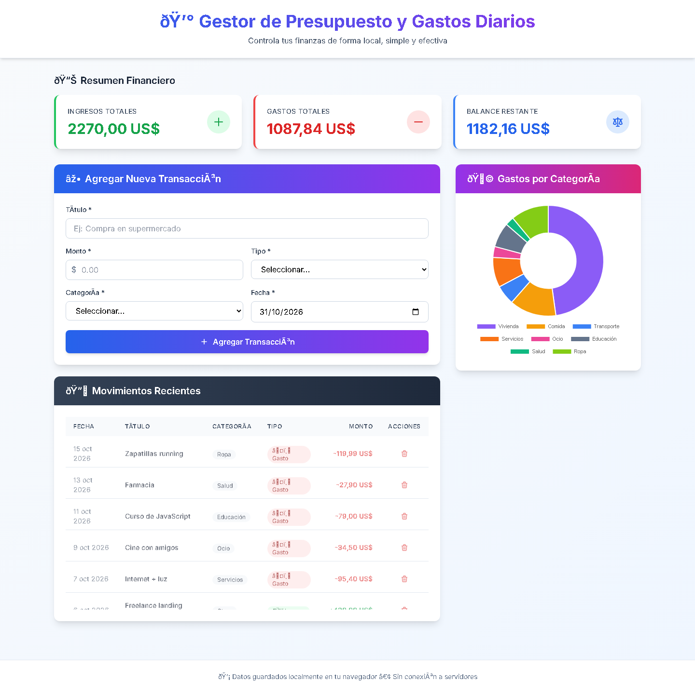

# 💰 PreGastos — Gestor de Presupuesto y Gastos Diarios

> Aplicación web para registrar ingresos y gastos, visualizar el balance en tiempo real y entender en qué se va la plata. Sin servidores, sin base de datos y sin fricción: todo corre en el navegador.

<p>
  
  
  
  
  
  
</p>



---

## 📌 Sobre el proyecto

**PreGastos** nace de una necesidad cotidiana: saber cuánto dinero entra, cuánto sale y en qué categorías se concentran los gastos, sin depender de una planilla de Excel ni de una app que pida registro.

El resultado es una **single-page application** de un solo archivo que funciona 100 % en el navegador. Los datos se guardan en `localStorage`, por lo que la aplicación es instantánea, funciona offline y no envía información personal a ningún servidor.

**El desafío técnico** fue lograr una experiencia de producto completa —formularios validados, métricas, tablas responsive y gráficos— sin frameworks ni build step, manteniendo el código legible y fácil de extender.

---

## ✨ Características

| | |
|---|---|
| 📊 **Resumen financiero en vivo** | Ingresos, gastos y balance se recalculan automáticamente en cada operación, con color según el saldo sea positivo o negativo. |
| ➕ **Registro de transacciones** | Formulario con validación de campos, monto decimal, tipo (ingreso/gasto), categoría y fecha. |
| 🍩 **Gráfico de gastos por categoría** | Doughnut chart interactivo con tooltips que muestran monto y porcentaje de participación. |
| 🗂️ **Nueve categorías con identidad visual** | Comida, Transporte, Ocio, Salud, Vivienda, Servicios, Educación, Ropa y Otros, cada una con un color consistente en el gráfico. |
| 📱 **Diseño responsive real** | Tabla en escritorio y tarjetas en móvil; todo el layout se adapta con Tailwind CSS. |
| 💾 **Persistencia local** | Las transacciones sobreviven al cierre del navegador gracias a `localStorage`, con manejo de errores de cuota. |
| 🛡️ **Prevención de XSS** | Todo texto ingresado por el usuario se escapa antes de inyectarse en el DOM. |
| 🔌 **Funciona offline** | No depende de un backend; solo requiere conexión para cargar las librerías desde CDN. |
| 🎯 **Feedback de interfaz** | Estados vacíos, confirmación antes de eliminar y animación de éxito al guardar. |

---

## 🖥️ Stack tecnológico

- **HTML5 semántico** — estructura sin frameworks de UI.
- **JavaScript (ES6+)** — estado derivado, renderizado dinámico, `Intl.NumberFormat` para moneda y fechas.
- **Tailwind CSS vía CDN** — sistema de diseño utilitario, sin compilación.
- **Chart.js vía CDN** — visualización de datos.
- **Web Storage API (`localStorage`)** — persistencia sin backend.
- **Google Fonts (Inter)** — tipografía del producto.

> **Decisión de diseño:** cero dependencias instalables y cero build step. El objetivo era que cualquier persona pueda clonar el repositorio y abrir el archivo, y que el proyecto sirva como ejercicio de fundamentos (DOM, estado, almacenamiento) antes de saltar a un framework.

---

## 📂 Estructura del proyecto

```
PreGastos/
├── index.html          # Aplicación completa: estructura, estilos y lógica
├── docs/
│   └── preview.png     # Captura usada en este README
├── LICENSE             # Licencia MIT
└── README.md
```

La lógica está organizada por responsabilidades dentro del mismo archivo:

```
Storage      → loadTransactions() / saveTransactions()
Cálculo      → renderMetrics()
Renderizado  → renderTransactions() / renderChart() / renderAll()
Formulario   → addTransaction() / deleteTransaction()
Utilidades   → formatCurrency() / formatDate() / escapeHtml()
```

---

## 🚀 Cómo ejecutarlo

No requiere instalación de dependencias ni compilación.

### Opción 1 — Abrir directamente

Descargá o cloná el repositorio y abrí `index.html` en tu navegador.

```bash
git clone https://github.com/Lurdciano/PreGastos.git
cd PreGastos
```

### Opción 2 — Servidor local (recomendado)

```bash
python -m http.server 8000
```

Luego ingresá a [http://localhost:8000](http://localhost:8000).

### Publicar en GitHub Pages

1. Subí el proyecto a GitHub.
2. Andá a **Settings → Pages**.
3. En *Source*, seleccioná **Deploy from a branch** y la rama `main` con carpeta `/ (root)`.
4. La app queda disponible en `https://lurdciano.github.io/PreGastos/`.

---

## 🧭 Cómo se usa

1. **Cargá un ingreso o gasto**: título, monto, tipo, categoría y fecha.
2. **Revisá el resumen**: ingresos, gastos y balance se actualizan al instante.
3. **Analizá el gráfico**: identificá qué categoría concentra tus gastos.
4. **Gestioná los movimientos**: la lista se ordena por fecha descendente y permite eliminar registros con confirmación.

Los datos quedan guardados en el navegador bajo la clave `pregastos_transactions_v1`.

---

## 🧠 Desafíos y aprendizajes

- **Estado derivado en lugar de estado duplicado.** Las métricas y el gráfico no se guardan: se recalculan desde el array de transacciones. Eso elimina una clase entera de bugs de sincronización.
- **Renderizado responsive sin duplicar lógica.** La tabla de escritorio y las tarjetas móviles se generan desde la misma fuente de datos, manteniendo una única lógica de negocio.
- **Seguridad desde el inicio.** Inyectar HTML con `innerHTML` es cómodo pero peligroso; la función `escapeHtml()` neutraliza cualquier intento de XSS en los campos del usuario.
- **Degradación elegante del gráfico.** Cuando no hay gastos, el canvas se oculta y se muestra un estado vacío; al volver a haber datos, la instancia de Chart.js se destruye y recrea correctamente.

---

## 🗺️ Roadmap

- [ ] Filtros por rango de fechas y por categoría.
- [ ] Edición de transacciones existentes.
- [ ] Presupuestos mensuales por categoría con alertas de límite.
- [ ] Exportación e importación de datos en JSON/CSV.
- [ ] Modo oscuro y selector de moneda.
- [ ] Migración a una PWA instalable con soporte offline completo.
- [ ] Tests unitarios para las funciones de cálculo y formateo.

---

## 👨‍💻 Autor

**Luciano Ruiz Diaz** — Desarrollador de software

[](https://github.com/Lurdciano)
[](https://www.linkedin.com/in/luciano-ruizdiaz)
[](mailto:lurdciano@gmail.com)

¿Te interesa el proyecto o querés comentar una mejora? Las sugerencias son bienvenidas a través de un *issue* o por correo.

---

## 📄 Licencia

Distribuido bajo la licencia **MIT**. Consultá [LICENSE](LICENSE) para más detalles.

<p align="center"><sub>Hecho con foco en la simplicidad, el rendimiento y el detalle.</sub></p>
